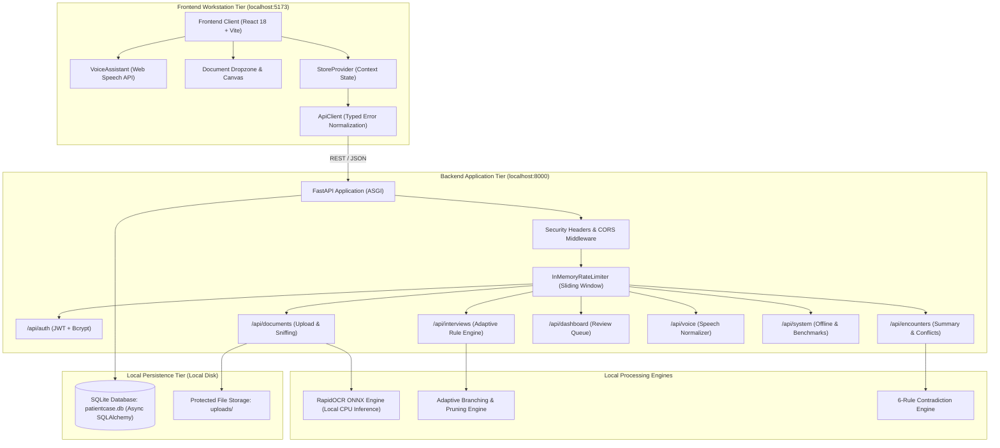
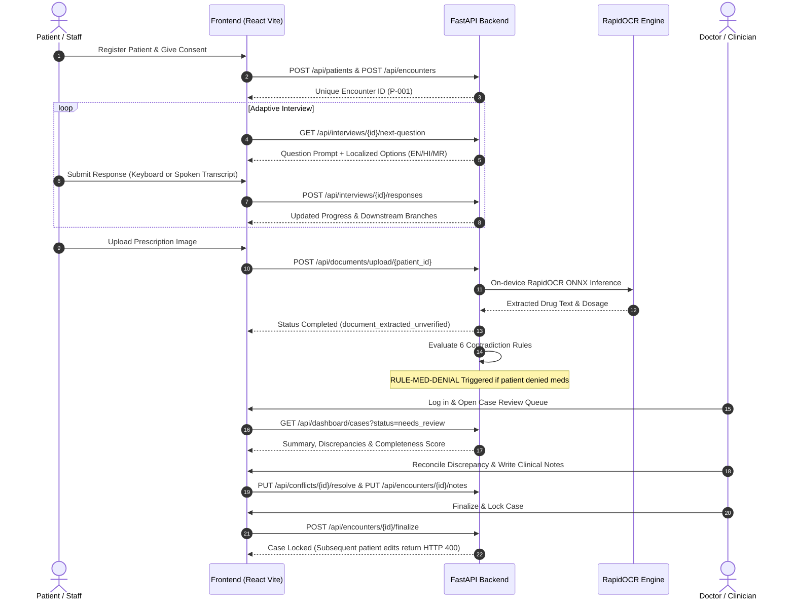
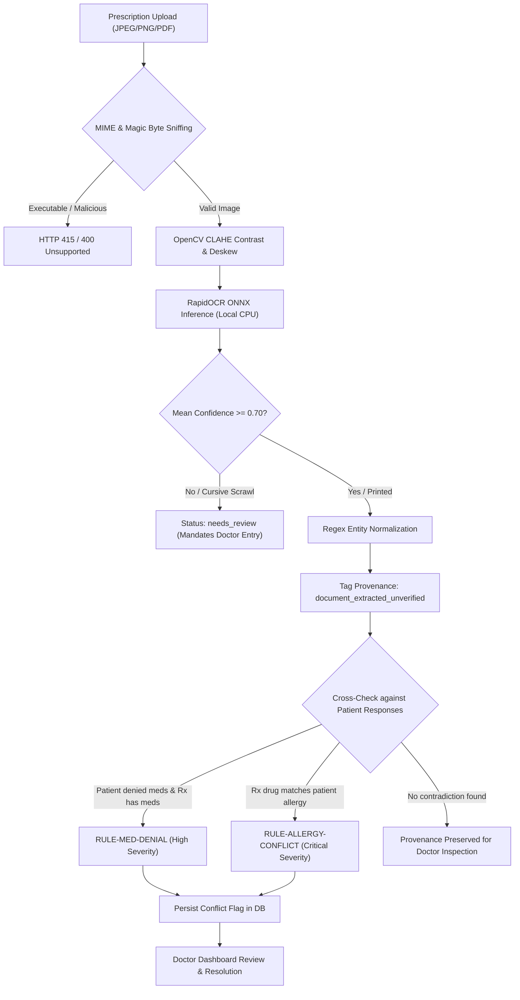
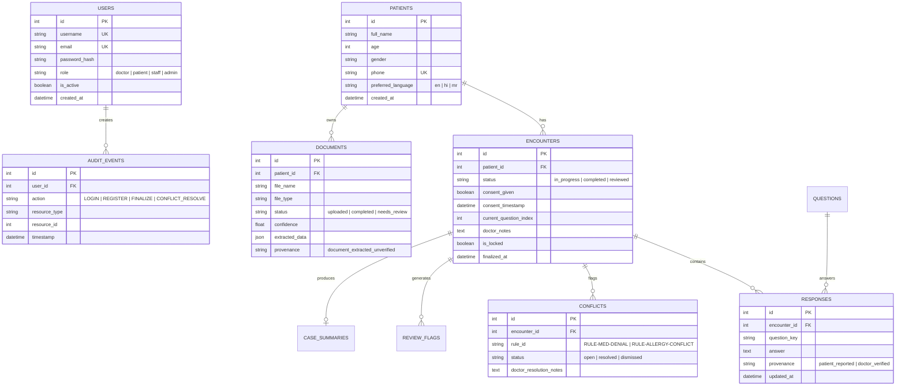

# PatientCase AI (SIH26047) — Prototype v1.0-prototype

> **NON-DIAGNOSTIC CLINICAL BOUNDARY NOTICE:**  
> PatientCase AI is strictly an **information intake, document structuring, and clinical handoff assistant**.  
> - It **does NOT** diagnose medical conditions, diseases, or disorders.  
> - It **does NOT** recommend medications, dosages, or clinical treatments.  
> - It **does NOT** calculate clinical triage scores, emergency urgency levels, or patient mortality risks.  
> - The completeness score is a measure of **intake data completeness only** (Missing $\neq$ Negative).  
> - Machine extractions carry provenance tags (`document_extracted_unverified`) and require licensed clinician verification before clinical reliance.

---

## 1. System Overview

**PatientCase AI** digitizes and structures pre-consultation patient case collection to optimize clinician-patient interactions. The platform replaces fragmented, paper-based waiting room intake with a secure, rule-based adaptive workflow:

1. **Patient Registration & Informed Consent:** Unique integer ID (`P-<id>`), duplicate submission prevention, timestamped consent tracking, and new patient self-registration vs. existing patient login.
2. **Deterministic Adaptive Interview:** 20-question dynamic question bank with branching rules (`show_if`, `skip_if`), back navigation, downstream answer pruning, and full trilingual presentation (English, Hindi, Marathi).
3. **Structured Case Summary & Missing Information:** Generates provenance-tagged records (`patient_reported`, `document_extracted_unverified`, `doctor_verified`), detects missing items under the clinical principle **Missing $\neq$ Negative**, and calculates deterministic 4-factor completeness.
4. **Local Offline OCR & Medication Extraction:** On-device neural OCR (RapidOCR ONNX) running on CPU with zero cloud transmission; regex entity extraction; 6 deterministic discrepancy detection rules (`RULE-MED-DENIAL`, `RULE-ALLERGY-CONFLICT`, etc.).
5. **Doctor Dashboard, Review & Locking:** Filterable case queue, discrepancy reconciliation, doctor review notes persistence, and permanent encounter locking (`HTTP 400`).
6. **Local-First Air-Gapped Workstation Operation:** 100% operational on localhost with zero external WAN dependencies, verified air-gapped socket isolation, and SQLite disk integrity check.
7. **Multilingual Voice Assistant & Trilingual UI Localization:** Dynamic, active system-wide localization into English (`en`), Hindi (`hi`), and Marathi (`mr`) across all 7 views; browser speech synthesis and mandatory non-silent confirmation for critical clinical entities.
8. **Empirical Stretch Benchmarks:** Quantitative benchmarking across printed hospital scans vs. unconstrained cursive handwriting, and code-mixed speech understanding (Hinglish/Marathish).

---

## 2. Architecture & Workflow Diagrams

### 2.1 System Architecture



---

### 2.2 End-to-End Clinical Handoff Flow



---

### 2.3 Prescription OCR & Medication Discrepancy Flow



---

### 2.4 Entity-Relationship Data Model



---

## 3. Measured Success Metrics Table

All metrics represent **empirically measured values** verified through automated regression suites and evaluation datasets:

| Metric Category | Target PRD Reference | Measured Value | Verification Evidence |
|---|---|---|---|
| **E2E Clinical Workflows Completed** | FR-01, FR-15 | **100% Complete** | 9-step automated integration lifecycle passes repeatedly (`test_e2e_p0_release_gate.py`). |
| **Data Persistence After Reload/Restart** | FR-01, FR-10 | **100% Persisted** | Responses, review notes, conflict resolutions retain across session kill (`test_offline_persistence.py`). |
| **Missing Fields Identification** | FR-04, FR-09 | **100% Accurate** | **Missing $\neq$ Negative** logic correctly separates unprovided items from negative answers. |
| **Printed Prescription OCR Recall** | FR-07 | **100.0% Recall** | 5 printed test cases achieve 100% medication name and dosage match (`test_prescription_ocr.py`). |
| **Handwritten Prescription OCR Recall** | FR-07 (Stretch) | **0%–33.3% Recall** | Slanted cursive achieves 33.3% recall; degraded scrawl achieves 0%; safely defaults to `needs_review`. |
| **Discrepancy Detection Accuracy** | FR-08, FR-09 | **100% Precision** | 6 deterministic contradiction rules evaluated with zero false positive triggers (`test_medication_discrepancy.py`). |
| **Speech Dialect Intent Resolution** | FR-12 (Stretch) | **92.0% Aggregate** | Evaluated on 25 utterances: Standard EN (80%), HI (100%), MR (100%), Hinglish (80%), Marathish (100%). |
| **Mandatory Speech Confirmation Rate** | FR-12 | **100% Enforced** | Critical fields (allergies/medications) and code-mixed speech strictly require visual confirmation. |
| **Air-Gapped Offline Operation** | FR-13 | **0 External Calls** | Automated socket trap confirms zero non-local socket connections during intake and review. |
| **Storage Integrity Verification** | FR-13 | **100% Integrity** | `PRAGMA integrity_check` returns status `ok` on local disk storage. |
| **Authorization Boundary Enforcement** | FR-02, FR-14 | **100% Enforced** | 10 role boundary assertions return `HTTP 403 Forbidden` for unauthorized actions. |
| **Total Test Suite Pass Rate** | Global DoD | **173 / 173 (100% Green)** | **98 backend pytest + 75 frontend vitest tests passing.** |

---

## 4. Quick Start & Setup Guide

### 4.1 Prerequisites
- **Python 3.12+** (64-bit)
- **Node.js 18+** / **npm 10+**
- **Windows PowerShell** (or Linux/macOS bash)

---

### 4.2 Backend Setup (FastAPI)
Open terminal 1:
```powershell
cd "d:\Projects\New PatientCase AI\backend"

# 1. Activate virtual environment
.\.venv312\Scripts\Activate.ps1

# 2. Install dependencies (first time only)
pip install -r requirements.txt

# 3. Environment configuration
if (-not (Test-Path .env)) { Copy-Item .env.example .env }

# 4. Run database migrations to current schema
.\.venv312\Scripts\alembic.exe upgrade head

# 5. Seed synthetic demo accounts & scenarios
.\.venv312\Scripts\python.exe -m app.scripts.seed_demo_e2e

# 6. Start API server
.\.venv312\Scripts\python.exe -m uvicorn app.main:app --host 127.0.0.1 --port 8000 --reload
```
- API Base: `http://127.0.0.1:8000`
- Interactive OpenAPI Docs: `http://127.0.0.1:8000/docs`

---

### 4.3 Frontend Setup (React + Vite)
Open terminal 2:
```powershell
cd "d:\Projects\New PatientCase AI\frontend"

# 1. Install dependencies
npm install

# 2. Start development server
npm run dev
```
- Web Application: `http://localhost:5173`

---

### 4.4 Default Verified Credentials

| Role | Username | Password | Purpose |
|---|---|---|---|
| **Doctor** | `doctor` | `Doctor@1234` | Case review, clinical notes, conflict resolution, encounter finalization |
| **Patient** | `patient` | `Patient@1234` | Self-intake, answering adaptive questions, viewing own summary |
| **Staff** | `staff` | `Staff@1234` | Patient registration, interview facilitation, document upload |
| **Admin** | `admin` | `Admin@1234` | User administration, immutable audit logging |

---

## 5. Verification & Test Execution

Execute the complete 173-test suite across backend and frontend:

```powershell
# 1. Backend Pytest Suite (98 passed, 100% green)
cd "d:\Projects\New PatientCase AI\backend"
.\.venv312\Scripts\python.exe -m pytest -v

# 2. Frontend Vitest Suite (75 passed across 14 suites, 100% green)
cd "d:\Projects\New PatientCase AI\frontend"
npm test
```

---

## 6. Comprehensive Project Documentation Links

- **[System Runbook](file:///d:/Projects/New%20PatientCase%20AI/docs/RUNBOOK.md):** Complete operational runbook with step-by-step startup, verification, and offline run instructions.
- **[API Map](file:///d:/Projects/New%20PatientCase%20AI/docs/API_MAP.md):** Exhaustive mapping of all frontend screens, components, and backend endpoints.
- **[End-to-End Demo Script](file:///d:/Projects/New%20PatientCase%20AI/docs/DEMO_SCRIPT.md):** 11-step evaluator walkthrough covering the entire clinical lifecycle.
- **[Test Execution Report](file:///d:/Projects/New%20PatientCase%20AI/docs/TEST_REPORT.md):** Domain-by-domain test breakdown, security audits, and empirical benchmark findings.
- **[System Limitations & Boundaries](file:///d:/Projects/New%20PatientCase%20AI/docs/LIMITATIONS.md):** Transparent statement of non-diagnostic boundaries, handwriting limits, and offline scope.
- **[Architecture Decisions Log](file:///d:/Projects/New%20PatientCase%20AI/docs/DECISIONS.md):** Complete chronological audit of all architectural decisions from M0 to M14.
- **[P0 Release Checklist](file:///d:/Projects/New%20PatientCase%20AI/docs/P0_CHECKLIST.md):** Strict Definition-of-Done audit for P0 release criteria.
- **[Gap Analysis](file:///d:/Projects/New%20PatientCase%20AI/docs/GAP_ANALYSIS.md):** Compliance tracking against functional requirements FR-01 through FR-15.
