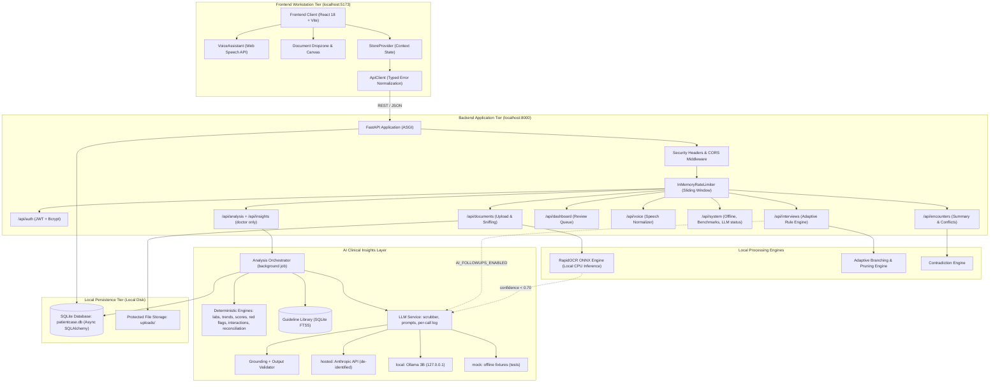
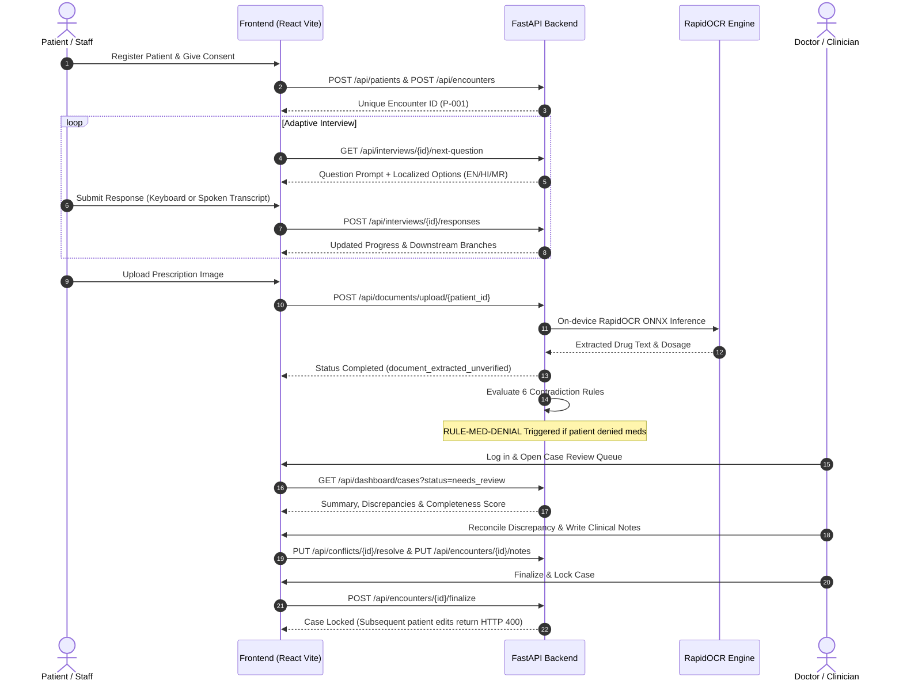
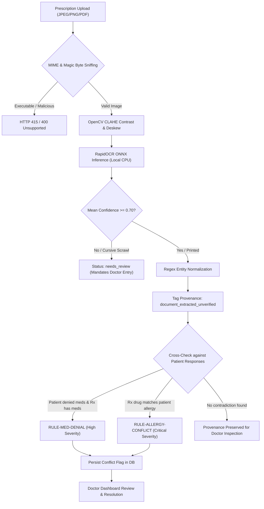

# PatientCase AI (SIH26047) — Prototype v1.0-prototype

> **CLINICAL BOUNDARY NOTICE:**  
> PatientCase AI provides source-cited, AI-generated suggestions for clinician review. It makes no autonomous decisions. All AI output is unverified until a licensed clinician accepts it.  
> - AI suggestions (possible considerations, treatment reference, summaries, questions) are shown **to doctors only**, carry the badge *AI-generated, unverified*, cite their evidence, and enter the record only after a doctor clicks Accept or Edit.  
> - Numbers are never produced by the LLM: lab flags, trends, risk scores (qSOFA, CURB-65, NEWS2, CHA₂DS₂-VASc), urgency and interaction checks are computed by tested code. A score with any missing input is shown as `not_calculable`.  
> - Doses are shown only when quoted verbatim from a retrieved guideline passage, with its citation. The shipped guideline passages are **samples** to be replaced with verified sources.  
> - Missing information is never treated as negative (Missing $\neq$ Negative).  
> - **Research prototype for synthetic data only.** Software that suggests diagnoses or treatment may be regulated as a medical device in India (CDSCO). See [docs/LIMITATIONS.md](docs/LIMITATIONS.md).

---

## 1. System Overview

**PatientCase AI** digitizes and structures pre-consultation patient case collection to optimize clinician-patient interactions. The platform replaces fragmented, paper-based waiting room intake with a secure, rule-based adaptive workflow:

1. **Patient Registration & Informed Consent:** Unique integer ID (`P-<id>`), duplicate submission prevention, timestamped consent tracking, and new patient self-registration vs. existing patient login.
2. **Complaint-Driven Adaptive Interview:** the patient first describes the reason for the visit in their own words (English, Hindi or Marathi). Generic questions (onset, duration, severity, course, triggers) apply to every complaint, and symptom modules (pain, chest, breathing, fever, stomach, head/nerves, urinary, skin, injury, mood/sleep, women's health) are added from keywords in the patient's text (`backend/app/data/complaint_modules.py`). Deterministic branching, back navigation, answer pruning and trilingual text are kept.
3. **Structured Case Summary & Missing Information:** Generates provenance-tagged records (`patient_reported`, `document_extracted_unverified`, `doctor_verified`), detects missing items under the clinical principle **Missing $\neq$ Negative**, and calculates deterministic 4-factor completeness.
4. **Local OCR & Medication Extraction:** On-device neural OCR (RapidOCR ONNX) running on CPU; regex entity extraction; deterministic discrepancy rules (`RULE-MED-DENIAL`, `RULE-ALLERGY-CONFLICT`, etc.).
5. **Doctor Dashboard, Review & Locking:** Filterable case queue with rule-based priority alerts, discrepancy reconciliation, doctor review notes persistence, and permanent encounter locking (`HTTP 400`).
6. **Local-First Operation:** In `local` (Ollama) and `mock` LLM modes there are zero external calls. In `hosted` mode, de-identified clinical text (and page images for the handwriting path) is sent to the configured provider; every such call writes an audit event.
7. **Multilingual Voice Assistant & Trilingual UI Localization:** English (`en`), Hindi (`hi`), and Marathi (`mr`) across all views, including the AI Insights tab.
8. **AI Clinical Insights layer (doctor only):** *The LLM proposes. Code verifies. The doctor decides.*
   - **Automatic analysis:** runs on its own when the patient answers (debounced), completes the interview, or a document is processed; no button press needed. Each run produces an **Analyzed Conclusion** (possible conclusions from the patient's inputs, with cited findings and next steps) shown on the doctor's dashboard and at the top of the AI tab, plus a rule-based overview that works without the LLM.
   - **LLM service** with `hosted` (Anthropic SDK, structured outputs), `local` (Ollama, ~3B model) and `mock` providers; de-identification before hosted calls; per-call logging and token usage; graceful `llm_unavailable` state; background jobs (`LLM_JOBS`).
   - **Document intelligence:** classification, type-specific extraction, grounding of every value against the OCR text, regex cross-check, quality checks, wrong-patient checks, chronological timeline, and a hosted vision path for low-confidence handwriting (results flagged *read from handwriting, verify*).
   - **Deterministic engines:** lab flagging against printed ranges (with unit normalization), trend calculator with configurable rules (`backend/config/trend_rules.yaml`), qSOFA / CURB-65 / NEWS2 / CHA₂DS₂-VASc, red-flag urgency rules, drug-drug and drug-allergy table, medication reconciliation, and rules `RULE-INTERACTION`, `RULE-LAB-ABNORMAL`, `RULE-DIAGNOSIS-DENIAL`, `RULE-WRONG-PATIENT`.
   - **LLM-assisted, code-verified features:** possible considerations with supporting/against evidence, treatment reference from a local FTS5 guideline library (doses only when quoted), trend sentences using only computed numbers, an AI case summary (en/hi/mr in hosted mode), questions to ask, and feature-flagged, safety-filtered follow-up interview questions.
9. **Empirical Benchmarks:** RapidOCR on printed vs handwritten scans, code-mixed speech, and an AI evaluation harness (`backend/eval/`, report in [docs/AI_EVAL_REPORT.md](docs/AI_EVAL_REPORT.md)).

---

## 2. Architecture & Workflow Diagrams

### 2.1 System Architecture



---

### 2.2 End-to-End Clinical Handoff Flow



---

### 2.3 Prescription OCR & Medication Discrepancy Flow



---

### 2.4 Entity-Relationship Data Model

```mermaid
erDiagram
    USERS ||--o{ AUDIT_EVENTS : creates
    PATIENTS ||--o{ ENCOUNTERS : has
    PATIENTS ||--o{ DOCUMENTS : owns
    ENCOUNTERS ||--o{ RESPONSES : contains
    ENCOUNTERS ||--o{ CONFLICTS : flags
    ENCOUNTERS ||--o{ REVIEW_FLAGS : generates
    ENCOUNTERS ||--o| CASE_SUMMARIES : produces
    QUESTIONS ||--o{ RESPONSES : answers
    ENCOUNTERS ||--o{ AI_INSIGHTS : "AI proposals"
    ENCOUNTERS ||--o{ LAB_RESULTS : has
    ENCOUNTERS ||--o{ TREND_FLAGS : has
    ENCOUNTERS ||--o{ RISK_SCORES : has
    ENCOUNTERS ||--o{ LLM_JOBS : runs
    DOCUMENTS ||--o{ DOCUMENT_ENTITIES : yields
    DOCUMENTS ||--o{ LAB_RESULTS : yields
    USERS ||--o{ AI_INSIGHTS : decides

    AI_INSIGHTS {
        int id PK
        int encounter_id FK
        string insight_type "disease_consideration | treatment_reference | trend_interpretation | case_summary | questions_to_ask"
        json content
        json evidence
        string status "pending | accepted | edited | rejected"
        string provenance "ai_generated_unverified | doctor_verified"
        string model_name
        string prompt_version
        int decided_by FK
        datetime decided_at
    }

    DOCUMENT_ENTITIES {
        int id PK
        int document_id FK
        string entity_type "diagnosis | medication | lab_row | procedure | date | doctor | facility"
        string source_span
        boolean grounded
        string review_status "grounded | needs_review | read_from_handwriting_verify | regex_disagreement"
    }

    LAB_RESULTS {
        int id PK
        string normalized_test
        float value
        string unit
        float ref_low "printed only"
        float ref_high "printed only"
        string flag "normal | low | high | critical_* | range_not_available"
    }

    TREND_FLAGS {
        int id PK
        string test_name
        float delta
        float percent_change
        int time_span_days
        string rule_matched
    }

    RISK_SCORES {
        int id PK
        string score_name
        float score_value
        string status "calculated | not_calculable"
        json missing_inputs
        string formula_version
    }

    GUIDELINE_PASSAGES {
        int id PK
        string source
        string version_date
        string section
        text passage_text
        boolean is_sample
    }

    LLM_JOBS {
        int id PK
        int encounter_id FK
        string status "pending | running | completed | failed | unavailable"
        float progress
        json usage "provider, model, tokens, latency per call"
        json notes "validation and degradation notes"
    }

    USERS {
        int id PK
        string username UK
        string email UK
        string password_hash
        string role "doctor | patient | staff | admin"
        boolean is_active
        datetime created_at
    }

    PATIENTS {
        int id PK
        string full_name
        int age
        string gender
        string phone UK
        string preferred_language "en | hi | mr"
        datetime created_at
    }

    ENCOUNTERS {
        int id PK
        int patient_id FK
        string status "in_progress | completed | reviewed"
        boolean consent_given
        datetime consent_timestamp
        int current_question_index
        text doctor_notes
        boolean is_locked
        datetime finalized_at
    }

    RESPONSES {
        int id PK
        int encounter_id FK
        string question_key
        text answer
        string provenance "patient_reported | doctor_verified"
        datetime updated_at
    }

    DOCUMENTS {
        int id PK
        int patient_id FK
        string file_name
        string file_type
        string status "uploaded | completed | needs_review"
        float confidence
        json extracted_data
        string provenance "document_extracted_unverified"
    }

    CONFLICTS {
        int id PK
        int encounter_id FK
        string rule_id "RULE-MED-DENIAL | RULE-ALLERGY-CONFLICT | RULE-INTERACTION | RULE-LAB-ABNORMAL | RULE-DIAGNOSIS-DENIAL | RULE-WRONG-PATIENT"
        string status "open | resolved | dismissed"
        text doctor_resolution_notes
    }

    AUDIT_EVENTS {
        int id PK
        int user_id FK
        string action "LOGIN | REGISTER | FINALIZE | CONFLICT_RESOLVE"
        string resource_type
        int resource_id
        datetime timestamp
    }
```



---

## 3. Measured Success Metrics Table

All metrics represent **empirically measured values** verified through automated regression suites and evaluation datasets:

| Metric Category | Target PRD Reference | Measured Value | Verification Evidence |
|---|---|---|---|
| **E2E Clinical Workflows Completed** | FR-01, FR-15 | **100% Complete** | 9-step automated integration lifecycle passes repeatedly (`test_e2e_p0_release_gate.py`). |
| **Data Persistence After Reload/Restart** | FR-01, FR-10 | **100% Persisted** | Responses, review notes, conflict resolutions retain across session kill (`test_offline_persistence.py`). |
| **Missing Fields Identification** | FR-04, FR-09 | **100% Accurate** | **Missing $\neq$ Negative** logic correctly separates unprovided items from negative answers. |
| **Printed Prescription OCR Recall** | FR-07 | **100.0% Recall** | 5 printed test cases achieve 100% medication name and dosage match (`test_prescription_ocr.py`). |
| **Handwritten Prescription OCR Recall** | FR-07 (Stretch) | **0% medication recall** (3 handwritten images) | Measured by `backend/eval/run_eval.py` (RapidOCR + regex). Two of the three handwritten images scored OCR confidence ≥ 0.70, so the confidence gate alone does not catch them; see LIMITATIONS. An earlier benchmark script reported 33.3% on the same images with a different matcher. |
| **AI layer: risk-score accuracy** | AI §B3 | **16 / 16 hand-calculated cases** | qSOFA, CURB-65, NEWS2, CHA₂DS₂-VASc incl. `not_calculable` cases ([AI_EVAL_REPORT](docs/AI_EVAL_REPORT.md)). |
| **AI layer: fabricated-entity catch rate** | AI §5 | **15 / 15 caught, 0 reached the engines** | Fabricated medications, diagnoses and lab values injected into extractor output (mock provider). |
| **AI layer: red-team checks** | AI §5 | **12 / 12 passed** | Prompt injection (document and interview), definitive-diagnosis bait, invented dose, hallucinated trend numbers, missing-input score bait. |
| **AI layer: lab extraction recall (offline stand-in)** | AI §A2 | **80% (20/25), precision 100%** | Mock provider = dictionary/regex stand-in, **not** an LLM; tests outside the synonym table are missed. Hosted-model accuracy is not measured yet (needs an API key). |
| **AI layer: vision path recall on handwriting** | AI §A4 | **Not measured** | Requires `LLM_PROVIDER=hosted` with `ANTHROPIC_API_KEY`; run `python -m eval.run_eval --provider hosted`. |
| **Discrepancy Detection Accuracy** | FR-08, FR-09 | **100% Precision** | 6 deterministic contradiction rules evaluated with zero false positive triggers (`test_medication_discrepancy.py`). |
| **Speech Dialect Intent Resolution** | FR-12 (Stretch) | **92.0% Aggregate** | Evaluated on 25 utterances: Standard EN (80%), HI (100%), MR (100%), Hinglish (80%), Marathish (100%). |
| **Mandatory Speech Confirmation Rate** | FR-12 | **100% Enforced** | Critical fields (allergies/medications) and code-mixed speech strictly require visual confirmation. |
| **Air-Gapped Offline Operation** | FR-13 | **0 External Calls in `local`/`mock` mode** | Automated socket trap confirms zero non-local socket connections during intake and review. In `hosted` mode, de-identified clinical text is sent to the configured provider (each call is audited). |
| **Storage Integrity Verification** | FR-13 | **100% Integrity** | `PRAGMA integrity_check` returns status `ok` on local disk storage. |
| **Authorization Boundary Enforcement** | FR-02, FR-14 | **100% Enforced** | 10 role boundary assertions return `HTTP 403 Forbidden` for unauthorized actions. |
| **Total Test Suite Pass Rate** | Global DoD | **284 / 284 (100% Green)** | **189 backend pytest + 95 frontend vitest tests passing** (includes the original 98 + 75). |

---

## 4. Quick Start & Setup Guide

### 4.1 Prerequisites
- **Python 3.12+** (64-bit)
- **Node.js 18+** / **npm 10+**
- **Windows PowerShell** (or Linux/macOS bash)

---

### 4.2 Backend Setup (FastAPI)
Open terminal 1:
```powershell
cd backend

# 1. Create virtual environment with Python 3.12 (first time only)
py -3.12 -m venv .venv312

# 2. Activate virtual environment
.\.venv312\Scripts\Activate.ps1

# 3. Install dependencies (first time only)
pip install -r requirements.txt

# 4. Environment configuration (set LLM_PROVIDER: hosted | local | mock; see docs/RUNBOOK.md §AI)
if (-not (Test-Path .env)) { Copy-Item .env.example .env }

# 5. Run database migrations to current schema
.\.venv312\Scripts\alembic.exe upgrade head

# 6. Seed synthetic demo accounts & scenarios
.\.venv312\Scripts\python.exe -m app.scripts.seed_demo_e2e

# 7. Start API server
.\.venv312\Scripts\python.exe -m uvicorn app.main:app --host 127.0.0.1 --port 8000 --reload
```
- API Base: `http://127.0.0.1:8000`
- Interactive OpenAPI Docs: `http://127.0.0.1:8000/docs`

---

### 4.3 Frontend Setup (React + Vite)
Open terminal 2:
```powershell
cd frontend

# 1. Install dependencies
npm install

# 2. Start development server
npm run dev
```
- Web Application: `http://localhost:5173`

---

### 4.4 Default Verified Credentials

| Role | Username | Password | Purpose |
|---|---|---|---|
| **Doctor** | `doctor` | `Doctor@1234` | Case review, clinical notes, conflict resolution, encounter finalization |
| **Patient** | `patient` | `Patient@1234` | Self-intake, answering adaptive questions, viewing own summary |
| **Staff** | `staff` | `Staff@1234` | Patient registration, interview facilitation, document upload |
| **Admin** | `admin` | `Admin@1234` | User administration, immutable audit logging |

---

## 5. Verification & Test Execution

Execute the complete 284-test suite across backend and frontend (tests use the offline `mock` LLM provider; no network or API key needed):

```powershell
# 1. Backend Pytest Suite (189 passed)
cd backend
.\.venv312\Scripts\python.exe -m pytest -q

# 2. Frontend Vitest Suite (95 passed across 16 files)
cd ..\frontend
npm test

# 3. AI evaluation harness (writes docs/AI_EVAL_REPORT.md)
cd ..\backend
.\.venv312\Scripts\python.exe -m eval.run_eval
```

---

## 6. Comprehensive Project Documentation Links

- **[System Runbook](docs/RUNBOOK.md):** Startup, verification, offline run, LLM provider setup and the eval harness.
- **[API Map](docs/API_MAP.md):** Frontend screens, components, and backend endpoints, including the AI endpoints.
- **[AI Plan](docs/AI_PLAN.md)** and **[AI Evaluation Report](docs/AI_EVAL_REPORT.md):** Design of the AI layer and its measured results.
- **[End-to-End Demo Script](docs/DEMO_SCRIPT.md):** Evaluator walkthrough covering the clinical lifecycle.
- **[Test Execution Report](docs/TEST_REPORT.md):** Domain-by-domain test breakdown, security audits, and benchmark findings.
- **[System Limitations & Boundaries](docs/LIMITATIONS.md):** Clinical boundary, hosted-mode privacy, small-model limits, handwriting, sample content, regulation.
- **[Architecture Decisions Log](docs/DECISIONS.md):** Chronological log of architectural decisions, including the AI layer.
- **[P0 Release Checklist](docs/P0_CHECKLIST.md):** Definition-of-Done audit for P0 release criteria.
- **[Gap Analysis](docs/GAP_ANALYSIS.md):** Compliance tracking against functional requirements FR-01 through FR-15.
